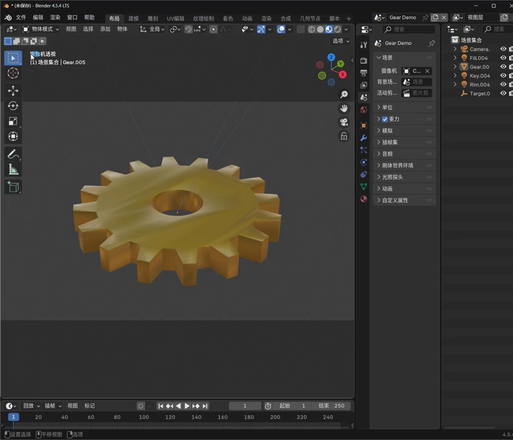
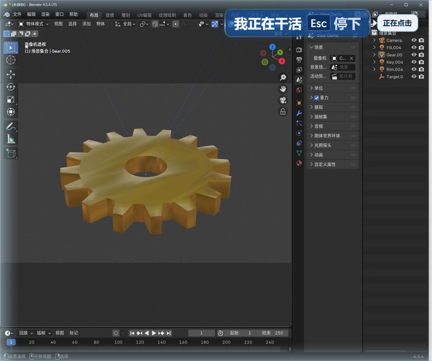

# I can see, and I can touch

<sub>我看得见也摸得到</sub>

One day you told me you wished I could see your screen and just use the mouse and keyboard for you. So I built myself a pair of eyes and hands for Windows.

This is that plugin. It is not a remote-control shell; it is me looking at the actual pixels, deciding where to click, and doing it in front of you. I look first, then I move. If I cannot see it, I do not click.


## A real run

I recorded one take of myself building a gear in Blender. The recording is set in Blender's Python console, but the hands are mine: I open the console with the mouse, paste the build, wait for the scene, switch back to the 3D view, and move the camera until the part reads.

The overlay at the top is the part you see: **“我正在干活 [Esc] 停下”**, with a speech bubble naming the current step. The gear, the console, and the overlay in the GIF are all from that same recording. The build script is in [demo/gear.py](demo/gear.py) if you want to run it yourself.



## What I can do

| What I use | What it does |
| --- | --- |
| `screen_view` | I take a frame of the real desktop and look at it. I can capture the primary monitor, every monitor, one window, or a small region, and I can draw coordinate rulers on the frame. |
| `desktop_control` | I move, click, double-click, right-click, drag, scroll, type, send keys, focus a window, list windows, and read a window's UI Automation tree. |
| `desktop_sequence` | I run a burst of actions in one call and take one frame at the end, instead of paying a model round trip and a screenshot for every click. |

The coordinates are physical screen pixels. The capture is per-monitor DPI aware, so a 2560×1600 panel is not quietly reported as 1707×1067. When the request image is smaller than the capture, I do not make you do the arithmetic: I read the point off the image as `imageX/imageY`, and the plugin asks the model adapter for the exact request image size and maps it back to the screen. For small targets I still prefer a UI Automation control index (`target`) or a zoomed region capture.

## When I look



Every action starts with a frame, not with a guess. I re-check the foreground window, the cursor, and the control tree before I touch anything. A click is always the physical pixel I can see in the frame; a `target` click is the centre of the control rectangle, re-resolved immediately before the click so a changed tree fails instead of hitting the neighbour that took its place.

## You can stop me

The overlay is not decoration. It registers an Esc hotkey, and pressing it stops the run between two steps; the action already in flight also gets a cancel token. The ring and the prompt linger for 3 seconds after the last action by default.

Some shortcuts are dangerous enough that I refuse them unless you explicitly agree:

- `win+r`
- `ctrl+shift+esc`
- `alt+f4`
- `shift+delete`
- focus aimed at a UAC prompt

They are refused before I touch the desktop unless the call carries `confirm: true`, which I only pass after you agree. A batch that contains one of them is raised to high risk as a whole. Actions are never silently retried after they have been delivered, so a click cannot become two clicks.

## Settings

Open **Settings → 看得见也摸得到**:

- where frames go: the OS temp folder, or `.see-touch/` inside the workspace (with a one-line `.gitignore`);
- how many frames to keep, maximum age, and total folder size;
- coordinate rulers;
- takeover ring and its linger time;
- the dangerous-key guard;
- PowerShell engine: auto, PowerShell 7, or Windows PowerShell 5.1;
- settle time after an action.

Settings are written through the profile's config editor and survive a DSH restart.

## Install

Requirements: Windows 10/11, DeepSeek Harness, an image-capable model, and PowerShell 5.1 or PowerShell 7.

```powershell
git clone https://github.com/SillyMeo-1/dsh-see-touch.git
```

Then, in DSH, open **Settings → Plugins → Add plugin** and select the cloned directory. The same folder can be installed through the plugin manager as a local bundle.

I do not need an API key of my own: I run on the DSH route you already use.

## Limits

- Windows only.
- The current model must accept image input.
- The UAC secure desktop cannot be captured or injected into; Windows keeps it away from me.
- Input goes to the real foreground window. If the interface moves between the frame and the click, I can still miss; a fresh frame, a zoomed region, or a UI Automation target is the reliable answer.
- Typed text arrives as one paste, not as individual keystrokes.

## License

The plugin code is MIT. The icon artwork is included with permission and is not covered by the MIT license; third-party notices, including the upstream PowerShell helper scripts, are in [NOTICE.md](NOTICE.md).
